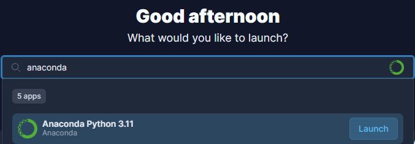
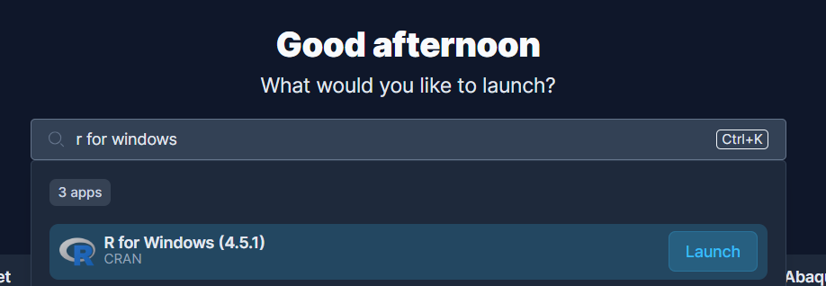
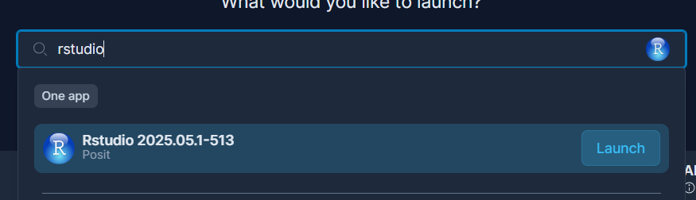

Before starting this practical session, you'll need to set up a few essential tools. Don't worry, we'll keep this brief!

## Required Software {.unnumbered}

Depending on your set-up, you can use any of the following steps:

:::{.panel-tabset}

### Using AppsAnywhere {.unnumbered}

If you're using [AppsAnywhere](https://appsanywhere.leeds.ac.uk/)(available on university computers or your own laptop):

1.  Open AppsAnywhere on your computer

2.  Search for and launch **Anaconda** (for Python)

    {width="551"}

3.  Search for and launch **VS Code** or **Positron**

4.  For R (optional), search for and launch **R for Windows** first, then **RStudio**

    {width="551"} {width="544"}

### Using your own laptop {.unnumbered}

This approach is recommended if you want more control over your installations and if you plan to continue using these tools after the session:

#### 1. Development Environment (IDE) {.unnumbered}

An **IDE** (Integrated Development Environment) provides a comprehensive workspace for coding. Popular options include:

**For Python:**

- **VS Code** from [Microsoft](https://code.visualstudio.com/) - Versatile IDE with extensions for Python, R, and more
- **Positron** from [Posit](https://github.com/posit-dev/positron) - Next-generation data science IDE supporting both Python and R

**For R:**

- **RStudio Desktop** (free) from [Posit](https://posit.co/download/rstudio-desktop/) - Specifically designed for R

#### 2. Programming Languages {.unnumbered}

##### Python

Python is a general-purpose programming language widely used for data science, machine learning, and AI.

To be able to run Python code in your own laptop. You have two options:

- **Option A - Global Python:** Every project you create/use will use the same Pyhon installation and packages.

  - Pros: Simple initial set up. Once installed, you run code directly without managing environments.
  - Cons: Slower initial setup and fragile over time. Installing or updating a package for one module can break older projects, and sharing your exact setup with teammates or markers is difficult
  - You can install Python in your system using the installers from [python.org](https://www.python.org/downloads/) (version 3.11 or higher recommended) or via [Anaconda](https://www.anaconda.com/download).

- **Option B - Project Environments via `pixi` (Recommended):** Python and all required libraries are self-contained inside each project folder.

  - Pros: Installs in seconds, prevents dependency conflicts between assignments, and guarantees your code runs identically on anyone else's machine.
  - Cons: Requires learning a couple of basic command-line interactions.
  - You will need to install `pixi` just once from [pixi.prefix.dev](https://pixi.prefix.dev/latest/#installation) just once. We will cover how to set up a project in [the first section](1-basics/index.qmd)

##### R (Optional)

R is another popular language for statistical computing. You can download the R installers from [CRAN](https://cran.r-project.org/)

### Using the Cloud {.unnumbered}

For the easiest setup and to ensure everyone is working in a consistent environment, we recommend using a cloud-based development environment in your browser—no local software installation required.

#### 1. GitHub Codespaces (Recommended) {.unnumbered}

**GitHub Codespaces** sets up a complete VS Code development environment in your browser with all required software pre-installed:

- **Zero Setup:** No need to install anything on your local machine.
- **Consistent Environment:** Everyone uses the exact same tools and configurations.
- **GitHub Account Required:** Includes 60 hours of free compute time per month for all GitHub accounts (and up to 180 hours via the [GitHub Student Developer Pack](https://education.github.com/pack)).

#### 2. Alternative Cloud Platforms {.unnumbered}

If you prefer a different cloud platform or don't have a GitHub account yet, you can also use:

- **[MyBinder](https://mybinder.org/v2/gh/itsleeds/introds/HEAD)**  — Launches an interactive JupyterLab environment directly from this repository with **no account or password required** (note: takes 1–3 minutes to start, and temporary changes are not saved after you close the tab unless downloaded).
- **[Google Colab](https://colab.research.google.com/github/itsleeds/introds)**  — Fast, reliable cloud Jupyter notebooks for Python and R (requires a Google account).
- **[Posit Cloud](https://posit.cloud/)** — Browser-based RStudio and Positron workspaces (ideal if you are focusing on R; free tier includes 25 compute hours/month).

::: callout-note
## Accessing Cloud Tools & Package Mirrors from Mainland China {.unnumbered}

If you are accessing course materials from mainland China (for example, during university holidays or while working on your dissertation) where Google Colab or GitHub may be restricted or slow:

- **Cloud Notebooks & IDEs:** **[Heywhale (和鲸社区 ModelWhale)](https://www.heywhale.com/)**, **[Alibaba Cloud ModelScope (阿里云魔搭社区)](https://modelscope.cn/)**, and **[Baidu AI Studio (飞桨星河社区)](https://aistudio.baidu.com/)** provide fast domestic cloud JupyterLab/IDE environments supporting Python and R with free compute tiers.
- **Fast Local Package Downloads:** If `pip`, `pixi`, `uv`, or `CRAN` downloads are slow on your laptop, use the **[Tsinghua University TUNA Mirror (`mirrors.tuna.tsinghua.edu.cn`)](https://mirrors.tuna.tsinghua.edu.cn/)** or **[Alibaba Cloud Mirrors (`mirrors.aliyun.com`)](https://developer.aliyun.com/mirror/)**.
:::

:::

## Getting Help {.unnumbered}

If you encounter installation issues:

- Check the [RStudio Support](https://support.posit.co/hc/en-us) page
- Visit [Stack Overflow](https://stackoverflow.com/) for troubleshooting
- Ask during the session!

::: callout-tip
## Pro Tip {.unnumbered}

If you run into installation issues before the session, don't spend too much time troubleshooting. We can help you during the practical!
:::

## Pre-Session Questionnaire {.unnumbered}

Once you have reviewed the setup options above, please complete the [Pre-Session Questionnaire](questionnaire.qmd) so we can tailor the sessions to your background and setup.
